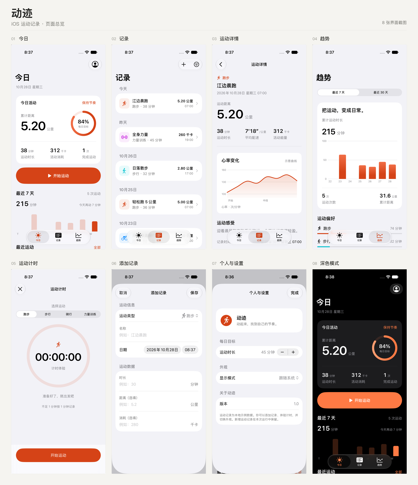
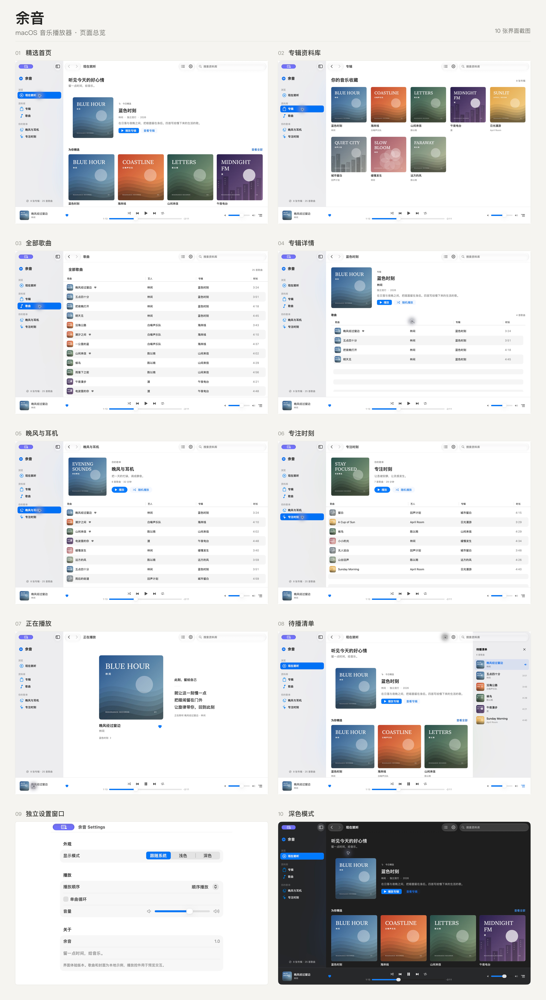

# Apple design

面向原生 iOS 与 macOS 应用的设计 Skill，附两套 SwiftUI 示例工程和完整页面截图。

将 Apple 平台设计规范整理为可按需读取的主题参考，让 AI 在设计、实现和审查界面时，兼顾系统组件、导航层级、排版、材质、动效与无障碍。

Native iOS and macOS design skills for AI coding agents, with SwiftUI sample apps and screen galleries.

## 两个 Skill

| Skill | 调用方式 | 适用范围 |
| --- | --- | --- |
| [iOS-design](ios-design/SKILL.md) | `$ios-design` | SwiftUI / UIKit；iPhone 优先及 iPad 自适应 |
| [MacOS-design](macos-design/SKILL.md) | `$macos-design` | SwiftUI / AppKit；窗口、分栏、菜单与键盘交互 |

每个目录均包含独立的 `SKILL.md`、`agents/openai.yaml` 和 `references/`。详细规则按任务加载，系统原则与项目推荐值分别标记。版本相关能力按目标 SDK 与最低系统版本选择。

视觉精修版补充了成套的布局密度、排版与光学对齐、深浅配色、组件状态和页面配方。按需可将层级、留白、对齐和信息密度用于其他平台，组件、尺寸与交互按目标平台调整。

## 安装到 Codex

```sh
git clone https://github.com/Fanch-hui/Apple-design.git
cd Apple-design
mkdir -p ~/.codex/skills
cp -R ios-design macos-design ~/.codex/skills/
```

若目标目录已有同名 Skill，先备份现有目录。安装后在新会话中调用：

```text
请使用 $ios-design，为运动记录 App 设计今日、记录和趋势页面。
```

```text
请使用 $macos-design，为音乐播放器设计资料库、播放队列和设置窗口。
```

也可从 [Releases](https://github.com/Fanch-hui/Apple-design/releases) 下载单独的 Skill ZIP，将其中完整目录放入 `~/.codex/skills/`。

## 示例与预览

示例以 UI 效果和本地交互为主，使用本地样例数据。

### 动迹 · iOS

运动记录界面，包括今日、记录、详情、趋势、计时、添加记录、个人设置和深色外观，共 8 张截图。

[源码与运行说明](examples/Motion) · [单页截图](examples/Motion/Preview) · [高清总览](docs/previews/motion-overview.png)



### 余音 · macOS

音乐播放器界面，包括精选、专辑、歌曲、专辑详情、两份歌单、正在播放、待播清单、设置和深色外观，共 10 张截图。播放操作用于界面演示，音频播放尚未实现。

[源码与运行说明](examples/Resonance) · [单页截图](examples/Resonance/Preview) · [高清总览](docs/previews/resonance-overview.png)



两套 `Preview/index.html` 均可下载后直接用浏览器打开，查看和放大各页截图。

## 运行示例

需要 macOS 与 Xcode。动迹最低支持 iOS 17，余音最低支持 macOS 14。打开对应的 `.xcodeproj`，选择同名 scheme 后运行；动迹选择 iPhone 模拟器。

工程文件已包含在仓库中。修改 `project.yml` 后，使用 [XcodeGen](https://github.com/yonaskolb/XcodeGen) 重新生成工程。真机运行时，在 Xcode 中设置自己的签名团队和 Bundle ID。

## 目录

```text
ios-design/                 iOS Skill 与主题参考
macos-design/               macOS Skill 与主题参考
examples/Motion/            iOS 运动记录原型与 8 张截图
examples/Resonance/         macOS 音乐播放器原型与 10 张截图
docs/                      研究规范、视觉精修版与页面总览
LICENSE                    MIT
```

## 资料与许可

| 平台 | 深度研究版 | 视觉精修版（2026-11-24） | 引用出处 |
| --- | --- | --- | --- |
| iOS | [设计规范](docs/ios-guidelines-2026.md) | [视觉精修版](docs/ios-visual-refinement-2026.md) | [资料来源](ios-design/references/sources.md) |
| macOS | [设计规范](docs/macos-guidelines-2026.md) | [视觉精修版](docs/macos-visual-refinement-2026.md) | [资料来源](macos-design/references/sources.md) |

本项目的 Skill、研究整理、示例代码及原创预览素材采用 [MIT License](LICENSE)。引用来源保留各自权利；Apple、iOS、macOS、SwiftUI 等名称与商标归其权利人所有。本项目为独立社区项目。
